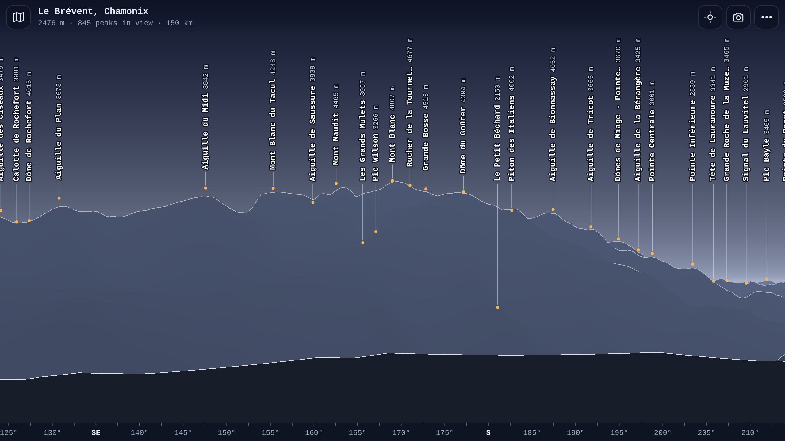

# Summits

Name the mountains around you. Live at https://summits.huy0x.dev.

The app computes the 360° horizon in the browser from open elevation data, labels the visible peaks, and can overlay them on the phone camera.



## How it works

- **Terrain**: Terrarium elevation tiles (AWS Open Data: SRTM, Copernicus, EU-DEM and others). Three zoom levels: z13 up to 6 km, z11 up to 40 km, z9 beyond. The Worker proxies them at `/api/tiles/z/x/y.png` and caches them for 30 days at the edge and for a year in the browser.
- **Horizon**: `public/horizon-worker.js` runs in a Web Worker. It casts 7,200 rays (one every 0.05°) out to 150 km, with Earth curvature and refraction (k = 0.13). Each column stores the visible surface as (angle, distance) steps.
- **Rendering**: `public/app.js` fills each screen column from those steps. A pixel is drawn as a ridge line when the terrain just above or beside it is much farther away (≥ 25 % and ≥ 400 m).
- **Peaks**: static files in `public/peaks/`, one per 2°×2° cell. A peak is labeled when its view angle clears the terrain in front of it.
- **Camera mode**: rear camera plus device orientation. Heading, pitch and roll come from the W3C rotation matrix; on iOS the heading comes from `webkitCompassHeading`.
- **Auto-align**: phone compasses drift by 5–15°, more near buildings. `public/align.js` finds the sky/terrain boundary in the camera frame (contrast in 2·B − R, so blue sky stands out from rock and forest). It then searches heading, pitch and zoom corrections until the computed far skyline sits on that boundary. The first lock searches ±25° and must beat every other fit by a clear margin. After that, it tracks drift every 0.6 s. Dragging turns it off; "Reset alignment" turns it back on.

## Peak data

Built once by `scripts/build-peaks.mjs` from two sources:

- GeoNames `allCountries` dump, feature codes PK, MT, VLC and HLL (CC BY 4.0), worldwide.
- OpenStreetMap `natural=peak|volcano` with a name (ODbL), currently only within 150 km of Chamonix. OSM wins; GeoNames points within 500 m of an OSM peak are dropped.

The public Overpass server refuses bulk exports. Adding OSM coverage for more regions needs a local Overpass instance or a Geofabrik extract run through `osmium tags-filter`.

```sh
unzip -p allCountries.zip allCountries.txt \
  | awk -F'\t' '$7=="T" && ($8=="PK"||$8=="MT"||$8=="VLC"||$8=="HLL")' > summits.tsv
node scripts/build-peaks.mjs --geonames summits.tsv --osm osm_peaks.tsv
```

## Develop and deploy

```sh
npx wrangler dev      # http://localhost:8787
npx wrangler deploy   # summits.huy0x.dev (custom domain in wrangler.jsonc)
```

URL parameters: `?lat=45.93391&lon=6.83783&name=Le+Brévent&snap=1`. `snap=1` moves the viewpoint to the highest terrain within 100 m, which suits named summits.
